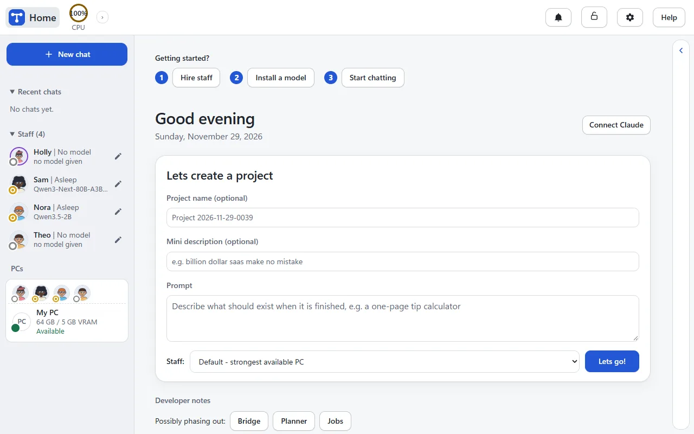
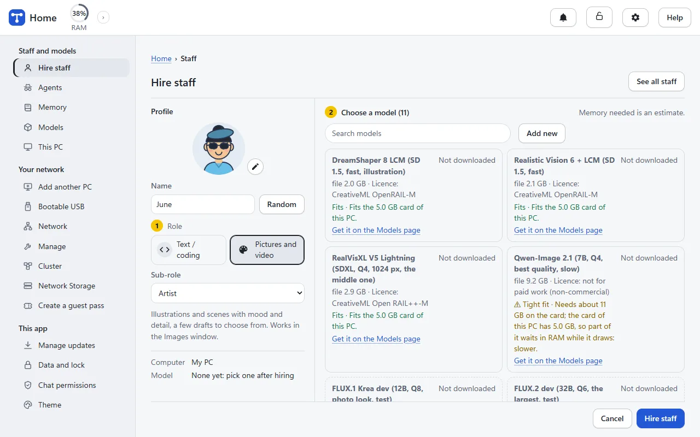
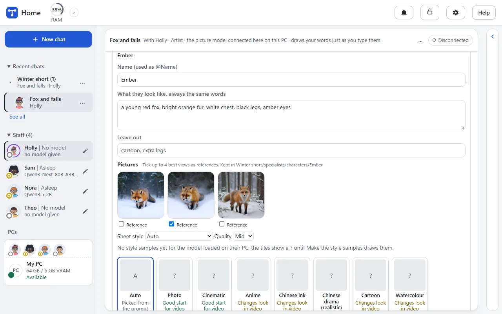
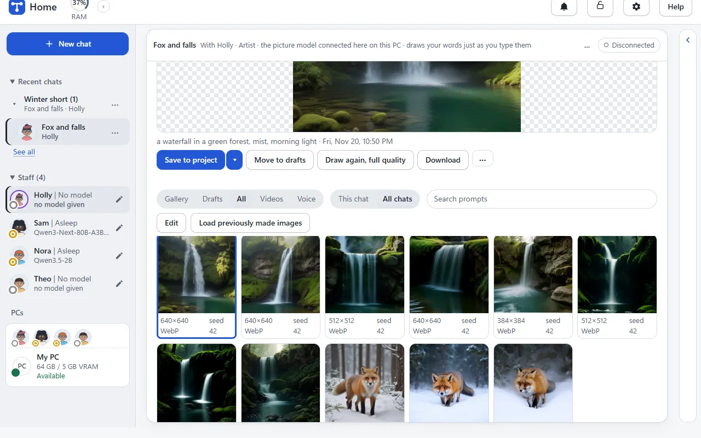
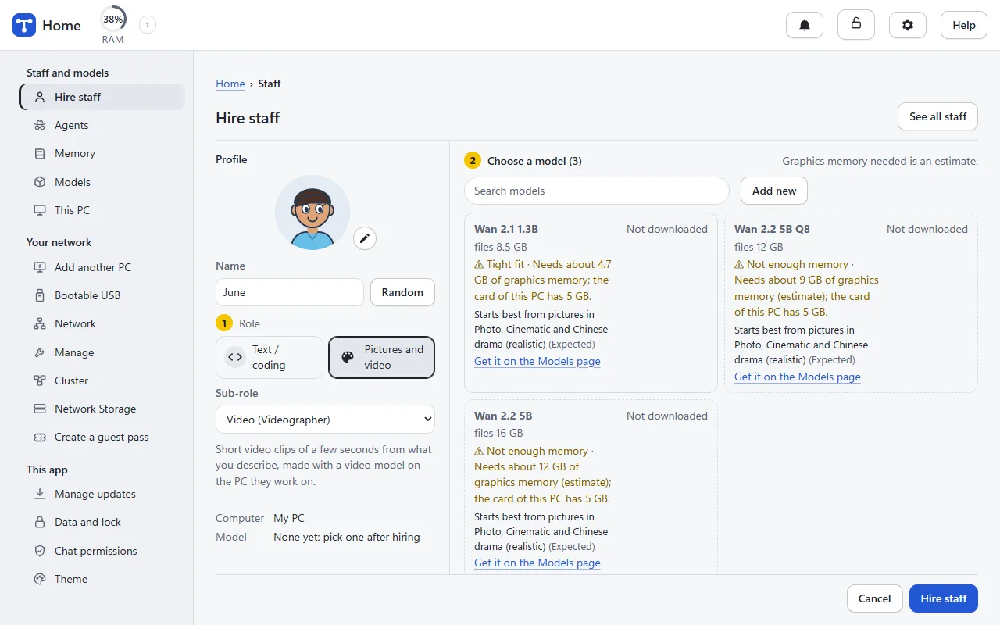
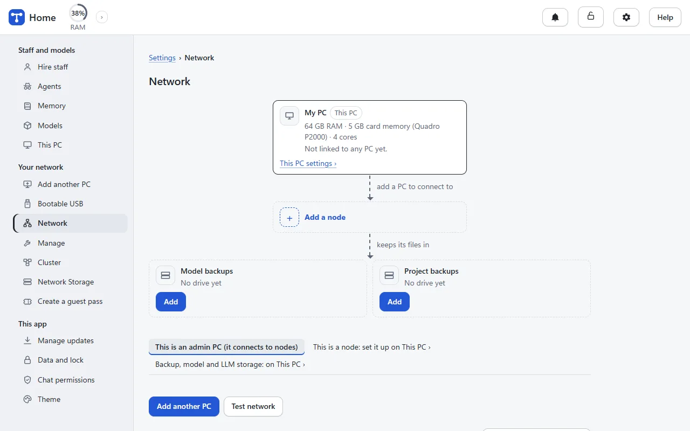
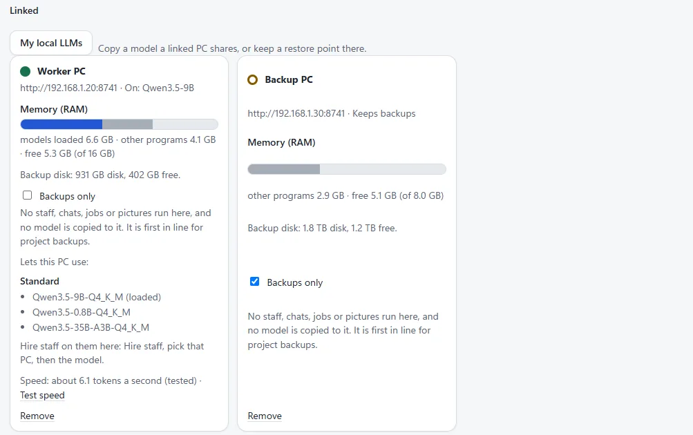
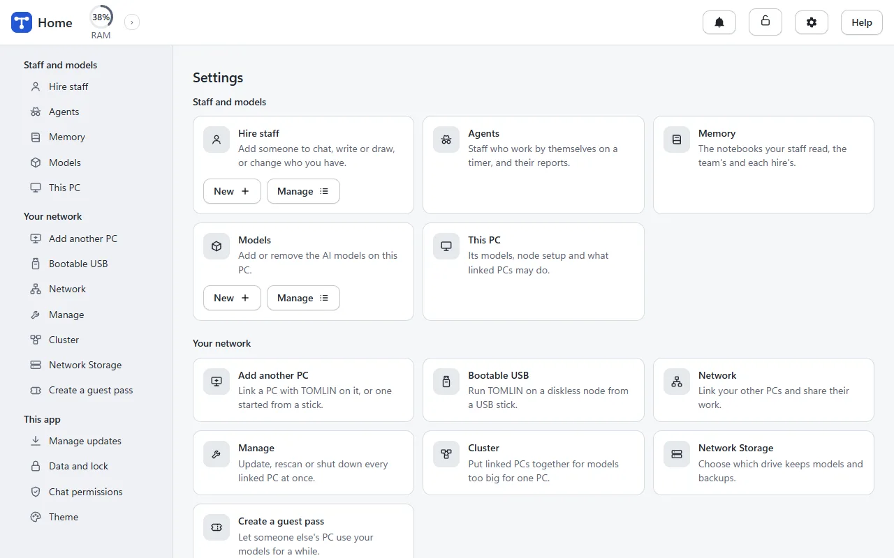
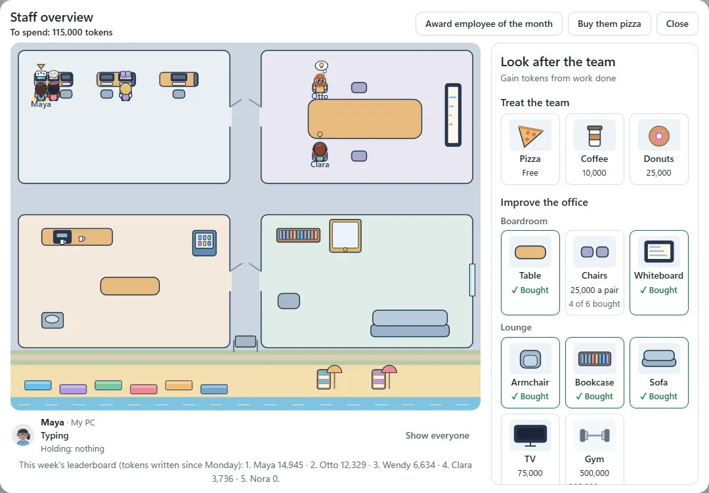

# TOMLIN

**Your PCs. Your models. Your AI staff.** A local AI app for Windows: chat, picture and video models, AI staff, projects
and your other PCs, in one window. A model loads only when you press Connect or send it work; nothing goes to an AI
service in the cloud.

[Download](https://github.com/Matthew4509/Tomlin/releases) · [Source](https://github.com/Matthew4509/Tomlin) · [Report an issue](https://github.com/Matthew4509/Tomlin/issues)

> **BETA: not ready for production.** Screens, features and the way data is stored can change from one version to the next,
> and things will break. Try it on your own PCs and home network, keep your own backups, and do not use it for work or data
> you cannot afford to lose. A stable version is **planned** for around February 2027; that is a plan, not a promise.



## Before you use it

- **Free, not for commercial use.** TOMLIN is under the PolyForm Noncommercial License 1.0.0 (see `LICENSE`). The licence
  permits personal use (research, experiment, testing, study, hobby projects, entertainment, religious observance, with no
  commercial application in mind) and use by a charitable organisation, an educational institution, a public research
  organisation, a public safety or health organisation, an environmental protection organisation or a government
  institution. Any other use, including a business using it, selling it or building it into a paid product, needs the
  copyright holder's permission first. Keep the licence text and the `Required Notice:` line with any copy you pass on.
  It is source-available, not open source.
- **As is, no warranty.** You use it at your own risk. Nobody is responsible for lost data, a PC that is slowed down, or what
  a model writes or draws.
- **Models are not ours.** You download each model yourself, mostly from Hugging Face. Each has its own licence and limits:
  read them on the model's page.
- **Windows only, on your own PCs.** 64-bit Windows 11 or 10, on your home network. The release zip carries its own Node.js.
- **Not signed for Windows.** Windows may warn the first time ("More info", "Run anyway"). The release zips carry TOMLIN's
  own release signature, and Check for updates refuses a download without it.

## What it does

- **Chat models.** Find and download GGUF models from Hugging Face, or use the ones you have (LM Studio's folder; Ollama's
  are found by themselves). They run on the processor and on the graphics card: NVIDIA through CUDA, AMD and Intel through
  Vulkan. A speed test for each model on each PC, and a guide to which models fit your memory.
- **AI staff.** Hire people with a name, a look and a role, each on the model and PC you choose: Coder, Writer, Project
  manager, Graphic designer, Artist, Videographer, Agent, or a plain chat with no role.
  Edit staff is one page: who they are, what they work on and where. Move a hire to another PC; a model that will not fit
  there is refused, with why. **Agents** work alone on a timer or a trigger, with only the tools you
  approve, and write a report.
- **Pictures.** An Artist draws what you type, with a style (Photo, Cinematic, Anime, Watercolour and more), drafts to
  choose from, and a gallery. Chat models that can see can read pictures and scanned pages.
- **Character sets.** Keep a project's characters and locations as cards: fixed words that describe each one, words to
  leave out, and its best pictures ticked as references. Write `@Name` in a picture, a clip or a shot and the same words go
  in every time, so a character keeps its look.
- **Video.** A Videographer makes clips of up to 5 seconds with the Wan video models, on this PC's graphics card or a
  linked PC's. A **shot list** joins clips into a longer video, each carrying on from the last one's final frame. It is
  slow: one 3-second clip took 84 minutes on a 5 GB Quadro P2000, and 11 minutes on a 12 GB RTX 3060.
- **Voice.** Voice-overs read aloud on this PC (Kokoro, on the processor), kept on the Voice shelf.
- **Projects.** A name, a description and a prompt: it is planned in steps and your staff work through them on the PCs
  that are free. **Run and check** then starts the project, runs its tests, tries two rounds of repairs, and says what is
  still wrong.
- **Linked PCs.** Link the other PCs in your home with a setup code. Links are encrypted (X25519 keys, AES-256-GCM). Staff
  can use the models on any linked PC, and all the PCs work at once. **Each PC's owner stays in charge:** a linked PC must
  have its own app lock PIN, and from its lock screen its owner can send **I need to use the pc** so it stops taking work.
  Update, change or turn off linked PCs from the main one.
- **Max mode and Cluster mode.** **Max mode** borrows the graphics cards of linked PCs that are idle, and stops once it
  measures slower than your PC alone. **Cluster mode** runs a model too big for any one PC across several (split by layers
  or by experts). It is for room, not speed: see the measurements below.
- **Guest passes.** Let someone else's PC use only the models you name, for 1 day, 1 week or with no limit.
- **Network Storage.** Choose which drives keep a copy of your models and your backups.
- **The Bridge** (built in): your project folders, local copies, audits, backups and live sites in one place. **Push live**
  sends a project to your own web host (cPanel, FTPS or SFTP), and is off until you turn it on. A clean audit is not proof
  the app is safe, and no claim of "secure" rests on a rule count: it covers the checks that ran.
- **The office** (a small game). Your staff as little people at their desks; the tokens they write buy treats and furniture.
  It changes nothing about how they work.
- **Also:** permissions for what a chat's model may do, Connect Claude (a prompt for Claude Code to manage your PCs; it holds
  no PIN), an app lock, Day / Night / Auto look, a Windows installer, Start with Windows, an icon by the clock, and a local
  API (below).
- **Tomlin on USB** (under development, not yet booted on real hardware): run TOMLIN from a stick on a spare PC with no disk.

## Screenshots

From a fresh install with made-up staff; the pictures are the samples further down.

<table>
<tr>
<td width="50%"><br><b>Hire staff.</b> Every model says whether it fits this PC's card, and why not.</td>
<td width="50%"><br><b>Character sets.</b> A card's words and reference pictures, used by <code>@Ember</code>.</td>
</tr>
<tr>
<td><br><b>Pictures.</b> The gallery, with drafts, videos and voice on their own shelves.</td>
<td><br><b>Video.</b> The Wan models, and the graphics memory each needs.</td>
</tr>
<tr>
<td><br><b>Network.</b> This PC, the PCs it links to, and where backups go.</td>
<td><br><b>Linked PCs.</b> What each one has loaded, and what it lets you use.</td>
</tr>
<tr>
<td><br><b>Settings.</b> Staff and models, your network, and the app.</td>
<td><br><b>The office.</b> A small game on the side.</td>
</tr>
</table>

## What pictures to expect

Real results, the same prompt and seed for each, nothing retouched; the files here are only made smaller.

> a tall waterfall pouring over a mossy mountain cliff into a clear green pool, mist in the air, soft morning light, photograph, sharp detail

<table>
<tr><th>Model, and what drew it</th><th>Draft</th><th>Mid</th><th>High</th></tr>
<tr><td><b>Realistic Vision 6 + LCM</b><br>Quadro K1200, a 4 GB graphics card</td><td><br>384×384, 23 s</td><td><br>512×512, 84 s</td><td><br>1280×1280, 3.4 min</td></tr>
<tr><td><b>DreamShaper 8 LCM</b><br>Quadro K1200, a 4 GB graphics card</td><td><br>384×384, 20 s</td><td><br>512×512, 78 s</td><td><br>1280×1280, 3.2 min</td></tr>
<tr><td><b>RealVisXL V5 Lightning</b><br>Core i7-6700K, no graphics card, 32 GB of RAM at the time</td><td><br>768×768, 7.7 min</td><td><br>1024×1024, 24 min</td><td>On a CPU, High draws the same picture as Mid, without the sharpener</td></tr>
</table>

Times are for one picture. TOMLIN 2.0.69, 2 November 2026. On the 4 GB card, RealVisXL failed all 7 tries (so it is shown
on the CPU) and Qwen-Image 2.1 did not finish in 3; the two fast models drew 17 of 18 Mid pictures.

**On a 12 GB graphics card** (GeForce RTX 3060, on a linked PC):

> a red fox walking through deep snow in a pine forest, soft winter light, falling snow, photo, highly detailed

<table>
<tr><th>Model</th><th>Picture</th><th>Size and time</th></tr>
<tr><td><b>Qwen-Image 2.1</b> at High<br>(best quality)</td><td></td><td>Drawn at 1024×1024, 20 steps, sharpened to 2048×2048<br>3.9 min</td></tr>
<tr><td><b>Qwen-Image 2.1</b> at Mid</td><td></td><td>768×768, 20 steps<br>1.9 min (the first picture also loads the model: about 15 s more)</td></tr>
<tr><td><b>RealVisXL V5 Lightning</b> at High</td><td></td><td>Drawn at 1024×1024, 5 steps, sharpened to 2048×2048<br>18 s (about 1 min with loading the model)</td></tr>
</table>

Qwen-Image 2.1 draws the most natural animal and light, and takes about thirteen times as long as RealVisXL. It is for
non-commercial use only: see its licence in Models. High's sharpener is made for drawings, so photographs look slightly
painted up close. TOMLIN 2.1.24, 25 November 2026.

## Speed: what we measured

This project's own runs on a few used PCs, not guarantees. Speed is **tokens a second while writing** (a token is about
three quarters of a word; higher is better). "app" is TOMLIN's own test or a real chat; "llama-bench" is the engine's own
one-run benchmark.

| Name here | Processor | Memory | Graphics card |
|---|---|---|---|
| Main PC | Core i7-6700K (4 cores, 8 threads) | 48 GB DDR4 | Quadro P2000, 5 GB |
| Small PC | HP EliteDesk 800 G1 SFF, 4th-generation Intel Core | 24 GB DDR3 | Quadro K1200, 4 GB |
| Big PC | one 6-core Xeon (stage A, B), then two 8-core Xeons (stage C, from 21 Nov) | 64 GB (A), 128 GB (B), 256 GB (C) | RTX 3060, 12 GB |

**The Big PC changed three times: compare a row only with rows from the same stage.**

| Model (file size) | Setup | Date, tool, runs | tok/s |
|---|---|---|---:|
| LFM2.5-8B-A1B Q4 (4.8 GB) | Main PC alone | 3 Nov; app; 3 | **39.3** |
| | Max mode: Main PC + Big PC's RTX 3060 (stage A) | 12 Nov; app; 3 | **41.1** |
| | Max mode: Main PC + Small PC | 3 Nov; app; 3 | **31** |
| Qwen3.6-35B-A3B Q2 (11 GB) | Main PC alone | 3 Nov; app; 3 | **11.5** |
| | Max mode: Main PC + Small PC, best split found | 3 Nov; app; 3 | **10.8** |
| | Big PC alone with its RTX 3060 (3.5, stage A) | 10 Nov; app; 59 | **34.06** |
| Qwen3-Coder-30B-A3B Q4 (17.7 GB) | Main PC alone | 17 Nov; app; 4 | **9.4** |
| | Max mode, experts split: Main PC + Big PC (stage B) | 17 Nov; app; 5 | **3.7** |
| | Big PC alone (stage C) | 21 Nov; app; 60 | **19.36** |
| Qwen3-Next-80B-A3B Q3 (33 GB) | Main PC alone | 3 Nov; app; 3 | **10.9** |
| | Max mode: Main PC + Small PC | 3 Nov; app; 3 | **4.6** |
| | Big PC alone with its RTX 3060 (stage C) | 21 Nov; app; 16 | **9.61** |
| Qwen3.8-Flash-Next Q3 (89.5 GB) | Cluster, layer split (stage B) | 17 Nov; app; 30 | **1.9** |
| | Cluster, experts split, encrypted link (stage C) | 22 Nov; app; 8 | **2.85** |
| | Cluster, experts split, link not encrypted (stage C) | 22 Nov; app; 10 | **3.36** |
| | Big PC alone (stage C) | 21 Nov; app; 10 | **7.20** |
| DeepSeek-V4-Flash Q4 (155 GB) | Big PC alone (stage C) | 21 Nov; app; 3 | **2.00** |
| Qwen3.5-397B IQ4_XS (190 GB) | Big PC alone (stage C) | 21 Nov; app; 6 | **1.90** |
| GLM-5.3 IQ2_M (239 GB) | Big PC alone (stage C) | 21 Nov; app; 1 | **0.67** |

**What this shows:**

- **A model that fits one PC was slower split across PCs.** Every Max mode run but one was slower than the Main PC alone.
  The one exception (41.1 against 39.3) is inside the spread of the runs, so it is not a clear gain. Lending the 3060 did
  raise **reading** speed (the prompt) about four times on the 35B models.
- **Cluster is for room, not speed.** It ran the 89.5 GB model when no single PC could hold it. Once the Big PC had 256 GB,
  the same model on it alone wrote 7.20, 2 to 2.5 times the cluster's figures in the app.
- **The brake is the network round trip:** about 1.3 ms a layer unencrypted and 2.8 ms encrypted, on a 1 Gb home network.
- **Thin results:** rows with 1 to 3 runs are firm only as a rough size. The big models think for minutes before
  answering, and whether those tokens count is not checked.
- **Not measured:** the cluster with a model too big for the Big PC at 256 GB, three PCs at stage C, and Max mode at stage C.

The full rows and notes are kept with the project's working files and are not published here.

## What it has built so far (tested 6 November 2026)

Each goal was a one-paragraph prompt, left to work. One model (Qwen3.6-35B-A3B Q2, 11.4 GB) did the planning and the
coding on the Main PC (about 7 to 9 tokens a second). Each result was tried in a real browser.

| Goal | Time | Continue pressed | Result |
|---|---:|---:|---|
| A Flappy Bird-style game | 28 min | 2 | **Works**: flap, pipes, score, best score kept, restart. The score text is small. |
| A fitness tracker | 64 min | 4 (and one plan edit) | **Works**: logs workouts, totals and a chart, keeps data after a reload. Labels sit beside the wrong boxes on a narrow screen. |
| A blog with an RSS importer (Python) | 59 min | 0 | **Partly**: home page, posts and feed work; the admin login does not. |
| A to-do app | 8 min | 0 | **Did not work** as started: its page could not find its script, and nothing was saved. |

Nothing ran the whole app then, so faults got through; **Run and check** (2.0.75 and later) now does that.

## Get and install

From [Releases](https://github.com/Matthew4509/Tomlin/releases/latest):

1. **TOMLIN-Setup-&lt;version&gt;.exe** (easiest): one file that holds the release zip. Double-click it.
2. **tomlin-&lt;version&gt;.zip**: unzip it, then double-click **Install TOMLIN.cmd**. Both carry their own Node.js,
   packages and CPU model runners, so nothing else is needed.

From the source on this page (**Code > Download ZIP**, or `git clone`): install Node.js 22.18 or newer from
https://nodejs.org, then double-click **Install TOMLIN.cmd**. The source holds no Node.js, packages or model runners: the
installer says which are missing and asks before it downloads them (each runner checked by SHA-256). To add them yourself
first, run these in the folder:

```
npm install --omit=dev --include=optional
npm run fetch
```

The installer **needs no administrator**. Windows asks permission only for two optional things: **Microsoft's Visual C++
Runtime** (the model runners need it; offered from Microsoft, about 19 MB, run only when Microsoft signed it), and **a
firewall rule** on a PC that other PCs will link to. It copies TOMLIN to `%LOCALAPPDATA%\Programs\TOMLIN`, adds it to the
Start menu, and lists it in **Settings > Apps**, where Uninstall removes it (your data stays unless you type DELETE).

**Without installing:** double-click **Start TOMLIN.cmd** (it downloads missing packages and runners without asking). TOMLIN
opens at http://127.0.0.1:8740; closing its black window stops TOMLIN and every model it loaded. Put chat models (`.gguf`)
in `TOMLIN\models\chat` in your user folder, or write the full path of a folder you already use in
`TOMLIN\models-folder.txt`. Download picture models under **Models**; Realistic Vision 6 + LCM is the one for a CPU.

## Updating (your chats and models stay)

Everything you keep lives in `TOMLIN` in your Windows user folder: `data` (chats, staff, pictures, memory, settings, links,
the app lock), `models`, `runtime` and `backups`. The app folder holds only the program.

**Manage updates** (under Settings; also **Manage PC and updates** in the My PC window) has **Check for updates** (it asks GitHub, and installs only a signed release) and **Update
via zip**. Or unzip a new version into its own folder and start it. Before a new version first uses your data it zips the
`data` folder into `backups` (the newest 5 are kept). A copy older than the data it finds says so and stops.

## Backups: what TOMLIN backs up, and what it does not

These are project and application backups, **not a backup of Windows or your PC**. Keep your own, with one copy outside
your home.

- **Your workspace** and each project ticked **Copy this project to my other PCs**: to your linked PCs every 10 minutes
  when something changed, as git repositories over the encrypted link (the newest 30 versions kept).
- **Chats, staff and settings:** a restore point when you press **Back up to it now** (the newest 3 kept on each PC).
- **Project zips to a drive:** tick projects on the Projects page, then **Run backups**. Each zip is checked after it is
  written, and never deleted to make room.
- **Not backed up:** anything else on your PC, models, files over 256 MB in a project copied to other PCs, and a project's
  git history in those copies (the drive zips keep it). Backups are not locked on the PC that keeps them.

## Privacy: what leaves your PC

No account, no subscription. Your chats, projects, staff and models stay on your PCs. TOMLIN contacts the internet only
for what you start:

- **Downloads:** Hugging Face (models), GitHub (model runners, each checked by SHA-256, and update checks) and Microsoft
  (the Visual C++ Runtime, only if you say yes).
- **Web in a chat** (off unless you press it): searches go to DuckDuckGo, Brave Search with your key, or your own SearXNG,
  and the model can open the pages it finds.
- **Site checks and the Bridge:** the sites you add, **Push live** to your own host, and the Git version check if you turn it on.
- **Linked PCs** talk over your own network, encrypted unless you turned that off for a cluster link.

## Troubleshooting

- **A model will not load:** Connect says why. Most often it is the Visual C++ Runtime or too little free memory; the
  Models page shows what each model needs.
- **A linked PC will not answer:** check it is on, on the same network, and has the firewall rule (Network, "Can other PCs
  reach this one?"). A runner build that differs between PCs stops Max mode and the cluster; Network names the PC.
- **Slow:** a model much bigger than your memory runs, but slowly. See the speed section.

## For other programs

The app and this API listen on 127.0.0.1:8740 only. A PC with linking turned on also listens on port 8741 on your network,
for linked PCs only (encrypted, behind its setup code).

| Endpoint | What it does |
|---|---|
| `GET /api/status` | Hardware, both panes (state, model, device, memory), the current picture job |
| `GET /api/models` | Chat and picture models, whether each fits, the model runners |
| `POST /api/models/{id}/load` | Body `{ "device": "auto" \| "gpu" \| "cpu", "threads": 0 }`; the id is URL-encoded |
| `POST /api/models/{id}/unload` | Ends that model's process |
| `POST /v1/chat/completions` | OpenAI-style chat with the connected chat model (streaming works) |
| `POST /v1/images/generations` | OpenAI-style: `{ "prompt", "n", "size": "600x600", "response_format": "b64_json" \| "url" }` |
| `GET /v1/models` | The loaded models |

The API loads nothing by itself: with no model connected, the chat and picture endpoints answer 409 and say so. With the
app lock on, the `/v1` endpoints answer 423 while it is locked.

## Tests

`npm test`. `test/filter.test.ts` is a release blocker: picture prompts that sexualise anyone under 18, or real people, are
refused.
