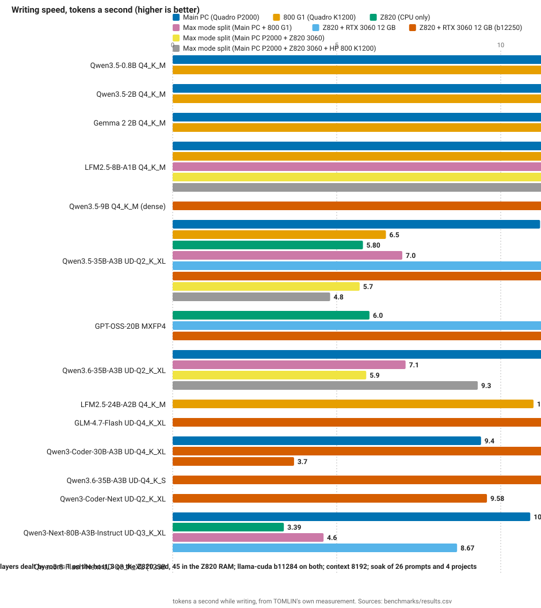

# TOMLIN speed results

How fast local models write on three ordinary used PCs, measured with [TOMLIN](https://github.com/Matthew4509/Tomlin).
Speed is **tokens a second while writing** (a token is about three quarters of a word; higher is better). Every figure comes
from TOMLIN's own measurement of the model server, and the raw rows are in [`results.csv`](results.csv).

## The PCs

| PC | Graphics card | Memory | Notes |
|---|---|---|---|
| **Main PC**: HP Z240 | Quadro P2000, 5 GB | 48 GB | Windows. Big models run with their expert layers in RAM. |
| **800 G1**: HP 800 G1 small-form-factor | Quadro K1200, 4 GB | 24 GB DDR3 | Windows. Lends its card to the Main PC in "Max mode". |
| **Z820**: HP Z820 Workstation, bought used | none used (2 x Quadro 2000, 1 GB each, too old for the model runners) | 64 GB DDR3, 256 GB SSD | 6-core Xeon E5-2640, Windows 10. **CPU only.** |

The Z820 was then fitted with an ASUS RTX 3060 12 GB (NVIDIA driver 560.94, card limited to 85% power to stay under 150 W). Its CUDA 12.4 runner was sent over the link from the Main PC; the "Z820 + RTX 3060 12 GB" column is the same tests with the card. The two Quadro 2000s are not used (TOMLIN found one CUDA device, the 3060).

## Models

All are GGUF files run by llama.cpp through TOMLIN's own runner. Sizes are the file on disk.

| Model | File | Size | Kind |
|---|---|---|---|
| Qwen3.5-0.8B | Q4_K_M | 0.5 GB | small dense |
| Qwen3.5-2B | Q4_K_M | 1.2 GB | small dense |
| Gemma 2 2B | Q4_K_M | 1.6 GB | small dense |
| LFM2.5-8B-A1B | Q4_K_M | 4.8 GB | mixture of experts (MoE), 1B active |
| LFM2.5-24B-A2B | Q4_K_M | 13.5 GB | MoE, 2B active |
| Qwen3.5-35B-A3B | UD-Q2_K_XL | 11.3 GB | MoE, 3B active |
| Qwen3.6-35B-A3B | UD-Q2_K_XL | 11.4 GB | MoE, 3B active |
| GPT-OSS-20B | MXFP4 | 11.3 GB | MoE, 3.6B active; **thinks before it answers** |
| Qwen3-Next-80B-A3B-Instruct | UD-Q3_K_XL | 33.2 GB | MoE, 3B active |

## Results

Median tokens a second while writing. Where a run has a range, it is the slowest to the fastest answer.

| Model | Main PC (P2000) | 800 G1 (K1200) | Max mode split (Main + 800 G1) | Z820, CPU only | Z820 + RTX 3060 12 GB |
|---|---|---|---|---|---|
| Qwen3.5-0.8B Q4_K_M | 63 | 38 | | | |
| Qwen3.5-2B Q4_K_M | 45 | 21 | | | |
| Gemma 2 2B Q4_K_M | 31.5 | 16.5 | | | |
| LFM2.5-8B-A1B Q4_K_M | 39.3 | 19.2 | 31 | | |
| LFM2.5-24B-A2B Q4_K_M | | 11.0 | | | |
| Qwen3.5-35B-A3B Q2 | 11.2 | 6.5 | 7.0 | **5.80** (5.68-5.89, 13 answers) | **34.06** (31.2-35.0, 59 answers) |
| Qwen3.6-35B-A3B Q2 | 11.5 | | 7.1 | | |
| GPT-OSS-20B MXFP4 | | | | **about 6.0** (4.96-6.40, 4 answers, Think on) | **31.59** (31.3-32.5, 10 answers, Think on) |
| Qwen3-Next-80B-A3B Q3 | 10.9 | does not fit | 4.6 | **3.39** (3.30-3.39, 6 answers) | **8.67** (8.53-9.15, 14 answers) |

What the numbers say:

- **A CPU-only Z820 writes the 35B model at 5.8 tokens a second**, within about 15% of the 800 G1 with its 4 GB card for the same file (6.5), and it does not slow down over 5 minutes (first half 5.80, second half 5.80).
- **The 33 GB, 80B model fits easily in 64 GB** and writes at 3.4 tokens a second on the CPU alone.
- **Splitting a model across two PCs over the network was slower than the Main PC alone** for every model that fits on it (35B: 7.0 against 11.2; 80B: 4.6 against 10.9). It only makes sense for a model too big for one PC.
- For mixture-of-experts models the **active** parameters set the speed, not the total: a 35B model with 3B active writes about as fast as a 20B one.

### A 125B model across two PCs (Qwen3.8-Flash-Next, 17 Nov 2026)

Qwen3.8-Flash-Next (125B total, 6B active, Unsloth UD-Q3_K_XL, 89.5 GB) does not fit on either PC alone, so TOMLIN's cluster split it: 1 layer on the Main PC, 3 on the Z820's card and 45 in the Z820's RAM. It loaded in 615 s from a hard disk and then wrote at **1.5 to 1.9 tokens a second**. It read prompts at only about **5 tokens a second** (a 2,000-token prompt took about 380 s), and the first answer after loading took 275 s. A soak of 26 prompts gave 23 clean answers, one error (a message longer than the 8,192 context) and two long waits; all four small projects (Flappy Bird, Snake, Pong, a Markdown converter with 17 passing tests) came back complete after one Continue each. The scripts in the three games parse; the games were not played.

### Max mode against one PC alone (Qwen3-Coder-30B-A3B, 17 Nov 2026)

The same five coding projects, one answer each, on the Main PC (Quadro P2000, 48 GB). **Alone: 9.4 tokens a second** (9.0 to 9.9). **Max mode with the Z820's RTX 3060 and RAM (expert parallel): 3.7** (3.6 to 3.8). The model fits one PC, and sharing its experts over the network cost 2.5 times the speed. TOMLIN measures the first Max load and, seeing it slower, declines Max mode for that model on the next load ("it was faster alone (9.4 against 3.7 tok/s)"). Max mode is for a model that fits one PC but where a borrowed card is faster; here it was not.

### TOMLIN against LM Studio (Main PC, Qwen3.6-35B-A3B Q2, 7 Nov 2026)

15 requests each (write, code and read prompts, 256/256/200 tokens, temperature 0). Raw rows in [`engines.csv`](engines.csv).

| Engine and settings | Tokens a second (median) | Range | First word, 730-token prompt |
|---|---|---|---|
| LM Studio 0.4.28, its defaults | 6.5 | 5.2-7.8 | 4.97 s |
| TOMLIN 2.0.75, its defaults | **10.0** | 8.9-10.3 | **3.91 s** |
| LM Studio, settings matched to TOMLIN's | **10.7** | 9.4-11.0 | 4.83 s |
| TOMLIN, settings matched to LM Studio's | 9.7 | 8.6-10.6 | 3.98 s |

With the same settings the two engines are within a few percent of each other. The difference out of the box is in the defaults each one picks.

## How the numbers were made

- **Earlier PC tests (3 Nov 2026, TOMLIN 2.0.7x):** TOMLIN's "Test speed", three runs per model; the speed finder's best setting is noted in `results.csv` where it gave more.
- **Z820 tests (10 Nov 2026, TOMLIN 2.0.81):** the model on the Z820 answered a fresh chat of about 150 words ("Run N. Write about 150 words on why people bake their own bread. Plain sentences."), one after another for 5 minutes, after one warm-up answer (which loads the model and is not counted). The figure is the Z820's own tokens a second for each answer; the link to the Main PC adds a little delay that is not in it. Settings: Run on CPU, context 8,192, threads left at the app's default.
- A 5-minute run you can repeat on your own PC: `tools/speedrun.ts` in TOMLIN 2.0.81 and later (`node tools/speedrun.ts --seconds 300`), which prints a speed for each minute and overall.

## Caveats

- Most rows are single runs on one PC each. Treat differences under about 10% as noise.
- Rows from different dates ran on different TOMLIN versions; the version is in `results.csv`.
- GPT-OSS-20B thinks for minutes before it writes (a warm-up of 287 s, one answer of 258 s), so a 5-minute window holds only two answers, and its figure is the least certain. With Think off it spent its whole allowance thinking and wrote nothing. It is not known whether its figure counts the thinking tokens.
- The CPU of the Z820 is a first-generation 6-core Xeon E5-2640 (it has AVX but not AVX2, which I infer from the 6-core model and have not confirmed), and its RAM speed and socket count are not recorded.
- Token counts per answer are not reported by the chat, so "tokens written" is an estimate from the speed and the time: about 1,800 for the 35B run and about 1,000 for the 80B run.

## Adding results

Add a row to `results.csv` (set `chart` to `yes` to put it on the chart), then run `node benchmarks/make-chart.mjs` to redraw `chart.svg`.
