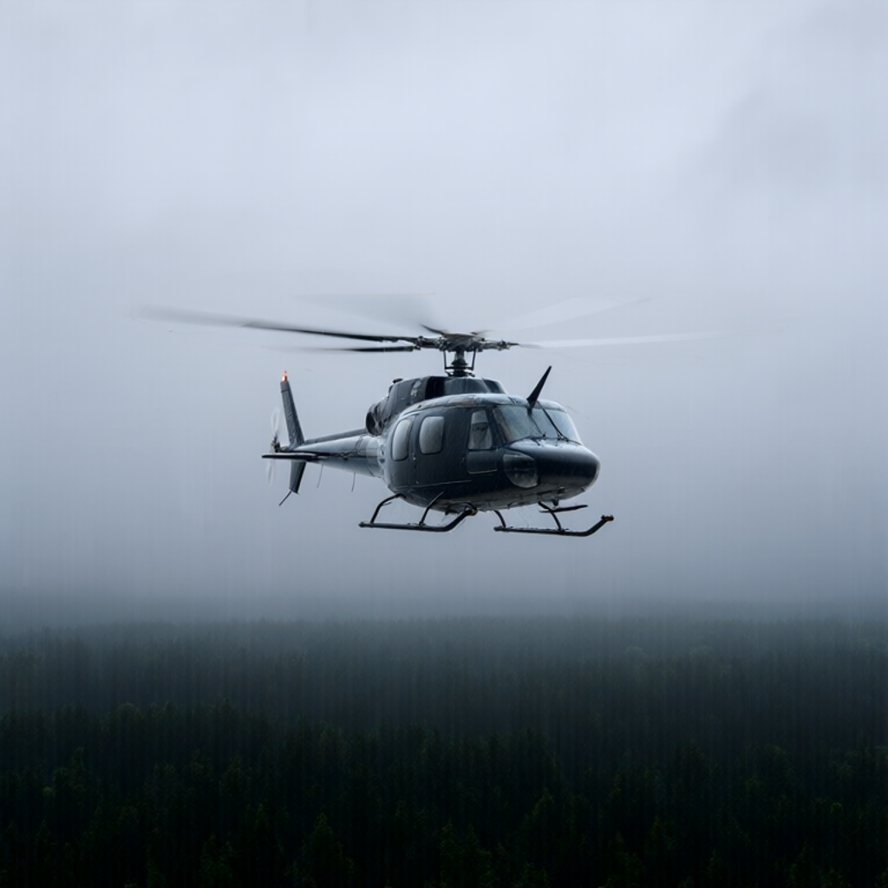
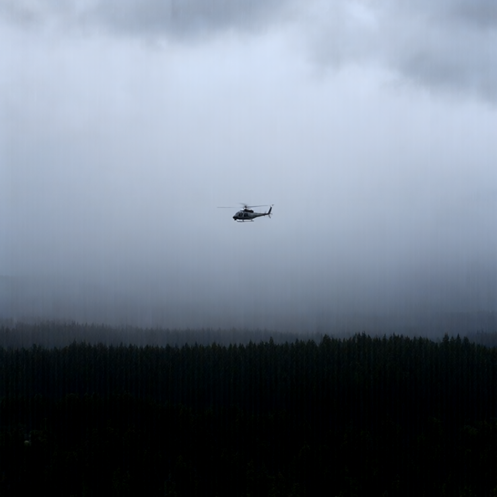

# Pictures: Qwen-Image 2.1 on an RTX 3060 12 GB (13 Nov 2026)

Two pictures drawn by TOMLIN 2.0.88 on a used workstation with a consumer graphics card. Nothing here was retouched, picked from a larger batch, or redrawn: these are the only two pictures made with this model in the test, both on the first try.

## The PC that drew them

| Part | What |
|---|---|
| PC | HP Z820 workstation, bought used |
| Processor | one 6-core Xeon E5-2640 |
| Memory | 64 GB |
| Graphics card | NVIDIA RTX 3060, 12 GB |
| System | Windows 10 |
| Asked from | another PC on the same home network (the picture is drawn on this PC and sent back) |

## The model and settings

| Setting | Value |
|---|---|
| Model | Qwen-Image 2.1, file `qwen_image_2.1-Q4_K.gguf` (about 9.9 GB) |
| Steps | 20 |
| Guidance (cfg) | 4 |
| Sampler | euler |
| Seed | 20261113 (both pictures) |
| Size asked | 1024 x 1024 |
| Size drawn | 768 x 768, then enlarged to 1024 x 1024 |
| Negative prompt (added by TOMLIN's Photo style) | cartoon, illustration, drawing, text, letters, watermark, signature, logo, deformed, blurry, lowres |
| Words added to the prompt by the Photo style | , photorealistic, natural light, high detail |

## Results

| Picture | Time to draw | File |
|---|---|---|
| A | 119.9 seconds | [helicopter-a.png](helicopter-a.png) |
| B | 117 seconds | [helicopter-b.png](helicopter-b.png) |

Loading the model before the first picture took about 12 seconds more.

### Picture A

Prompt, word for word:

> a medium civilian helicopter in flight, seen from below at a low angle, clearly high above the forest canopy against a grey overcast rainy sky, long streaks of rain, rotor blades blurred, tail boom and tail rotor clearly visible, dense evergreen forest far below in mist, cinematic photograph, sharp detail

What came out: the whole aircraft is sharp (cabin, skids, tail boom, tail rotor, blurred main rotor), it is above the treeline, and there are faint rain streaks.

### Picture B

Prompt, word for word:

> Wide aerial photograph of a civilian helicopter flying in the open sky well above a dark evergreen forest. The helicopter is small in the frame and entirely above the treetops, with grey rain clouds behind it and the forest canopy filling the bottom third of the picture. Heavy rain streaks across the whole scene. Realistic, sharp, natural overcast light.

What came out: the layout asked for. The helicopter is small (about 120 pixels wide), so it has little detail.

## Faults to know about

- Both pictures were drawn at 768 x 768 and enlarged, not drawn at 1024 x 1024 as asked.
- Both show faint vertical banding, strongest in the dark forest of picture B.
- The negative prompt typed for the test did not reach the drawing PC; only the Photo style's own list above was used.

## For comparison

The same prompt as picture A, on the same PC, with RealVisXL V5 Lightning (5 steps, a true 1024 x 1024): about 18 seconds a picture, a well-formed helicopter, but all three tries put it among the trees in fog with no rain. Qwen-Image 2.1 followed the prompt; it took about six times as long.

## Licence

Qwen-Image 2.1 is under the Qwen research licence: non-commercial use only (research or evaluation). These pictures are shared as test results only.
